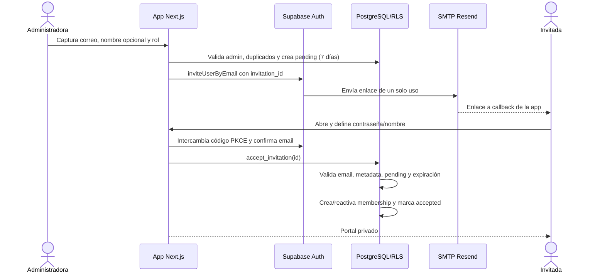

# Flujo de invitación

## Estados y errores
- `pending`: esperando aceptación; expira en una hora, alineado al plazo predeterminado del enlace Auth.
- `accepted`: usuario validado y membresía activada.
- `expired`: vencida; se debe crear una nueva invitación.
- `revoked`: cancelada por admin; no puede aceptarse.
- Correo registrado con membresía en el equipo: no se invita de nuevo.
- Cuenta Auth ya existente: Supabase puede rechazar la invitación; se informa sin revelar datos sensibles.
- Enlace usado, email distinto, inválido o expirado: no activa membresía; muestra estado seguro.
- Reenvío: reenvía invitación pendiente por la API Auth Admin; errores se presentan de forma comprensible.
- Error SMTP: se marca la invitación como revocada al fallar el envío inicial, evitando dejar un pendiente que no recibió correo.

No se guardan tokens en la tabla ni se envían invitaciones de prueba a terceros.
